# CodePath Cloud: Project Study and Launch Guide

A guide to how this website works, from the HTML page in your browser to the database, and how to run, change and launch it. It is written for a beginner who wants to learn, with enough exact detail for a developer who has to maintain the project.

**How to read the references.** A reference such as `server/src/app.js:39` means "file `server/src/app.js`, line 39". Line numbers match commit `f979740` on `main` (27 October 2026); they drift as the code changes, so search for the quoted function name if a line has moved. Facts that depend on a live service are marked **verified live** (checked on 27 October 2026 with read-only requests) or **not verified** (with how to check).

## Contents

1. [Project overview](#1-project-overview)
2. [Architecture](#2-architecture)
3. [Repository map](#3-repository-map)
4. [Web development foundations in this project](#4-web-development-foundations-in-this-project)
5. [Frontend details](#5-frontend-details)
6. [Backend and API](#6-backend-and-api)
7. [Database and data flow](#7-database-and-data-flow)
8. [Setting up and working on the project](#8-setting-up-and-working-on-the-project)
9. [Making the project live](#9-making-the-project-live)
10. [Maintenance and troubleshooting](#10-maintenance-and-troubleshooting)
11. [Study materials](#11-study-materials)

---

## 1. Project overview

### What the website does

CodePath Cloud is a website for learning **cybersecurity**. Students follow a guided roadmap and video courses, answer questions inside the videos, take an exam at the end of each block, and track their progress, weak topics and certificates. Instructors and admins create and edit content and upload lesson videos.

> The root `package.json` still describes the project as "a platform for learning programming" (`package.json:5`). That text is out of date: the four programming courses are retired (see below) and the site is cybersecurity-only (`client/index.html:6`, `client/index.html:15`).

### Who uses it

The code has three roles, defined in the database enum `Role` (`server/prisma/schema.prisma:15`):

| Role | What they can do | Where it is enforced |
| --- | --- | --- |
| `STUDENT` | Learn, track progress, take exams, earn certificates. Every new account is a student. | `server/src/routes/auth.js:31` (no role field at sign-up), `:42` |
| `INSTRUCTOR` | Everything a student can, plus create and edit content; edit and upload videos only on paths assigned to them. | `server/src/routes/manage.js:16`, `:27` (`assertCanManage`) |
| `ADMIN` | Everything, plus manage users and roles, see system status, apply catalog updates. | `server/src/routes/admin.js:15` |

### Major features (confirmed in code)

| Feature | Main code |
| --- | --- |
| Sign up, sign in, profile, password change | `server/src/routes/auth.js`, `client/src/pages/Auth.jsx`, `client/src/pages/Profile.jsx` |
| Password reset by email (single-use, expiring links) | `server/src/routes/auth.js:160`, `:196`, `:207`; `server/src/lib/mailer.js` |
| Path catalog with search and level filter | `server/src/routes/roadmaps.js:42`, `client/src/pages/Paths.jsx` |
| Roadmap "Cybersecurity: Foundations to Specialization" drawn as a winding road | `client/src/components/RoadmapMap.jsx`, `server/src/catalog/cyber-roadmap.js` |
| Course player: video lessons with in-video questions, sequential unlocking, 80% rules | `client/src/pages/CoursePlayer.jsx`, `server/src/services/coursePlayer.js` |
| Block exams (stage exams) with saved attempts, explanations and retries; optional skip tests | `server/src/services/coursePlayer.js:269`–`:447`, `client/src/pages/BlockQuiz.jsx` |
| Weak-topic detection (below 70% → review) | `server/src/services/learning.js:9`, `:28` |
| Dashboard, bookmarks, learning streak | `server/src/routes/me.js:97`, `:280` |
| Certificates with public verification links | `server/src/services/certificates.js:88`, `server/src/routes/certificates.js:12` |
| Downloadable roadmap PDF and print page | `server/src/services/roadmapHandout.js`, `client/src/pages/RoadmapPrint.jsx` |
| Instructor content editor and video uploads to object storage | `server/src/routes/manage.js`, `client/src/components/VideoUploadDialog.jsx` |
| Admin: users and roles, system status, test email, course catalog update | `server/src/routes/admin.js`, `client/src/pages/admin/` |
| Animated "Matrix" number rain (hidden while studying) | `client/src/components/MatrixRain.jsx` |

**Retired courses.** The four old programming paths (`frontend`, `dotnet-backend`, `python-backend`, `ai-fullstack`) are unpublished, not deleted, so learner history is kept (`server/src/services/courseCatalog.js:238`; migration `server/prisma/migrations/20261028000000_cyber_roadmap/`).

### What is verified and what is not

| Fact | Status |
| --- | --- |
| Everything about code structure and behavior in this guide | Read from the source at commit `f979740` |
| The website is served by Vercel at `https://code-path-cloud.vercel.app` | **Verified live** (`Server: Vercel` response header) |
| The API is served by Render at `https://codepath-api-1u5o.onrender.com` and its database is reachable | **Verified live** (`x-render-origin-server: Render` header; `/health` returned `"database":"ok"`) |
| The live website calls that API | **Verified live** (the only API address inside the deployed JavaScript) |
| The API allows the website's origin (CORS) | **Verified live** (`access-control-allow-origin: https://code-path-cloud.vercel.app`) |
| The database is a Neon PostgreSQL project | **Verified** (its migration history matches this repository's six migrations exactly, the latest applied during a Render deploy) |
| The example API address in the docs (`https://codepath-api.onrender.com`) belongs to this project | **Verified false**: it is a different service (see [section 9](#conflicting-or-outdated-configuration-and-documents)) |
| Which environment variables are set on Render or Vercel, and their values | **Not verified** (needs dashboard access; see [section 9](#9-making-the-project-live)) |
| Whether email delivery works in production | **Not verified** (see [section 10](#10-maintenance-and-troubleshooting)) |
| Whether video-upload storage is configured in production | **Not verified** (check Admin → System → Video storage) |
| Whether the Render service was created from `render.yaml` (Blueprint) or by hand | **Not verified** (check the Render dashboard; see [section 9](#9-making-the-project-live)) |

---

## 2. Architecture

### The big picture

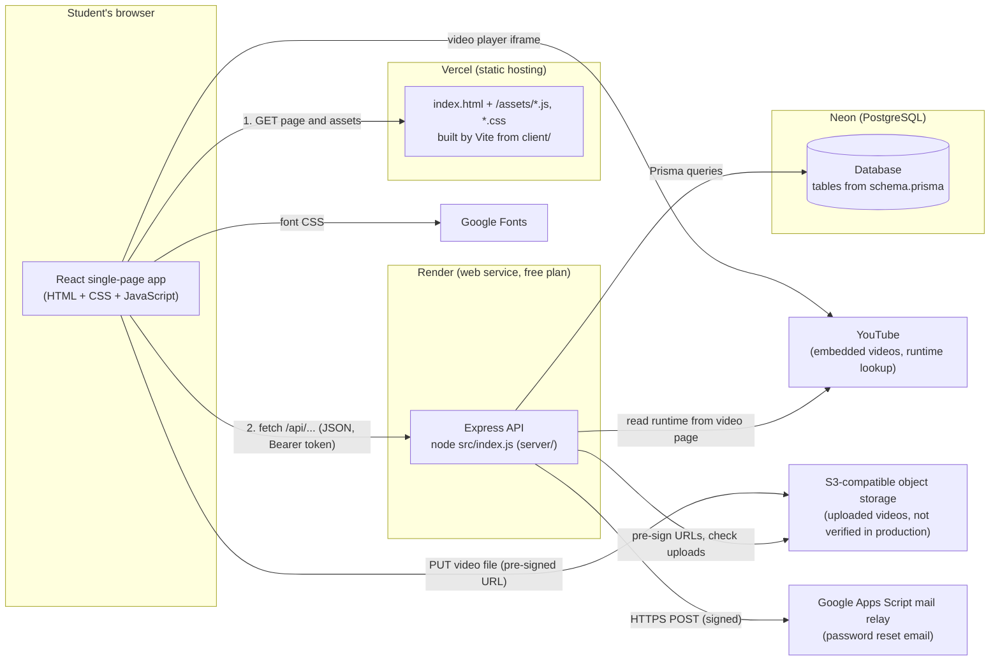

Where each part is hosted, and how that was established:

| Part | Host | Evidence |
| --- | --- | --- |
| Frontend (`client/`) | Vercel | `client/vercel.json`; live `Server: Vercel` header |
| API (`server/`) | Render web service | `render.yaml:3`–`:11`; live `x-render-origin-server: Render` header |
| Database | Neon PostgreSQL | `server/.env.example:3` recommends Neon; live migration history matched |
| Password-reset email | Google Apps Script web app (Gmail) | `render.yaml:28`–`:33`, `server/apps-script/`; whether it is deployed is **not verified** |
| Uploaded videos | Any S3-compatible bucket | `server/src/lib/storage.js`, `render.yaml:34`–`:42`; production setting **not verified** |

The repository also contains **alternative** hosting configs that are not what production uses: `client/netlify.toml` (Netlify) and a full Docker setup (`docker-compose.yml`, `client/Dockerfile`, `client/nginx.conf`, `server/Dockerfile`) for running everything on one machine. Section 9 lists every [conflicting or outdated hosting configuration](#conflicting-or-outdated-configuration-and-documents), including an example API address in the docs that belongs to a different service.

### How a page request travels

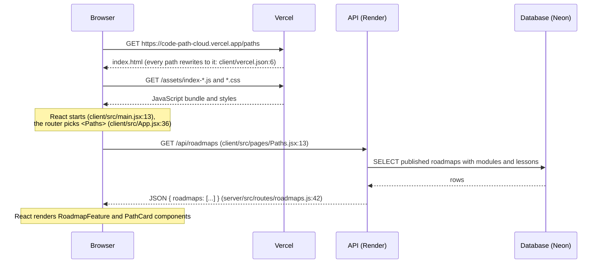

In plain language:

1. The browser asks Vercel for the page. Vercel always answers with the same `index.html` (`client/vercel.json:6`), because this is a **single-page application**: one HTML page, and JavaScript decides what to show for each address.
2. `index.html` loads the JavaScript bundle (`client/index.html:19`). React starts, reads the address `/paths`, and chooses the `Paths` page (`client/src/App.jsx:36`).
3. The page asks the API for data with `fetch` (`client/src/api/client.js:45`). The API runs on a different host (Render), so the browser first checks that the API allows the website's origin (CORS, `server/src/app.js:25`).
4. The API queries the database through Prisma and returns JSON.
5. React turns the JSON into HTML elements on the page.

### How a user action travels (example: answering an in-video question)

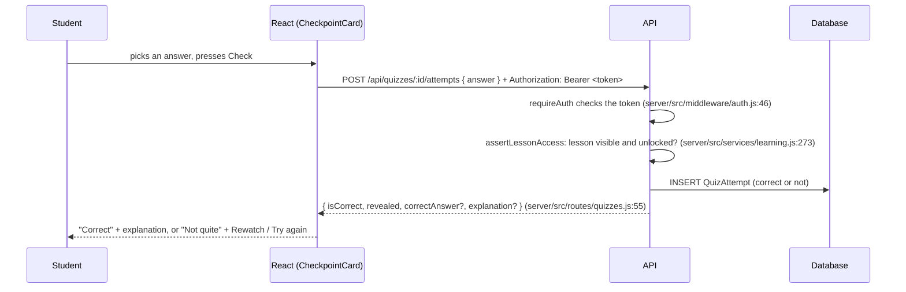

---

## 3. Repository map

### Stack at a glance

| Item | What the project uses | Source |
| --- | --- | --- |
| Language | JavaScript (ES modules), JSX for React; no TypeScript | `client/package.json:5`, `server/package.json:6` (`"type": "module"`) |
| Package manager | **npm** (each app has its own `package-lock.json`) | `client/package-lock.json`, `server/package-lock.json` |
| Node.js version | 20.19 or newer (`engines`); Render and Docker use Node 22 | `client/package.json:6`, `server/package.json:8`, `render.yaml:15`, `server/Dockerfile:1` |
| Frontend framework | React 19 with React Router 7 | `client/package.json:17`–`:20` |
| Frontend build tool | Vite 8 | `client/package.json:25`, `client/vite.config.js` |
| Backend framework | Express 5 | `server/package.json:35` |
| Database access | Prisma 6.19 (ORM) on PostgreSQL | `server/package.json:32`, `:41`; `server/prisma/schema.prisma:5` |
| Validation | Zod 4 | `server/package.json:42` |
| Auth | JSON Web Tokens (`jsonwebtoken`) + bcrypt password hashes (`bcryptjs`) | `server/package.json:33`, `:38` |
| Security headers / rate limits | Helmet, express-rate-limit | `server/package.json:36`, `:37` |
| PDF generation | PDFKit | `server/package.json:40` |
| Object storage | AWS SDK v3 S3 client (works with any S3-compatible storage) | `server/package.json:30`–`:31` |
| Icons, Markdown, code highlighting | lucide-react, react-markdown + remark-gfm, highlight.js | `client/package.json:15`–`:21` |
| Tests and linting | **None in the repository**: there is no test runner, test script or ESLint config. The available checks are the build and the catalog scripts ([section 8](#8-setting-up-and-working-on-the-project)). | `package.json`, `client/package.json`, `server/package.json` |

### Folder map

```text
CodePath-Cloud/
├── package.json            Convenience scripts that run the client and server scripts
├── README.md               Project readme (features, setup, rules)
├── render.yaml             Render Blueprint for the API service
├── docker-compose.yml      Optional: database + API + web app on one machine
├── .env.docker.example     Variables for docker-compose
├── docs/                   This guide and the video runtime audit
├── client/                 The website (React + Vite)
│   ├── index.html          The single HTML page
│   ├── vite.config.js      Dev server on port 5173, proxies /api to the API
│   ├── vercel.json         Vercel build settings and the single-page rewrite
│   ├── netlify.toml        Alternative host (not used in production)
│   ├── Dockerfile, nginx.conf   Docker build of the static site
│   ├── public/             Files copied as-is (favicon.svg)
│   └── src/
│       ├── main.jsx        Starts React; wraps the app in providers
│       ├── App.jsx         Every page route
│       ├── api/client.js   The one function that talks to the API
│       ├── context/        Signed-in user (AuthContext), toasts (ToastContext)
│       ├── i18n/           All interface text (en.js) and formatters
│       ├── lib/            Small hooks and helpers (useFetch, useReducedMotion, videoTimes...)
│       ├── components/     Reusable pieces (Layout, PathCard, RoadmapMap, VideoPlayer...)
│       ├── pages/          One file per screen; manage/ for instructors, admin/ for admins
│       └── styles/         Plain CSS: index.css, player.css, matrix.css, code.css
└── server/                 The API (Express + Prisma)
    ├── Dockerfile          Docker build of the API
    ├── prisma/
    │   ├── schema.prisma   The database tables (the source of truth)
    │   ├── migrations/     SQL changes applied in order
    │   ├── seed.js         Sample data for local development
    │   └── seed-data/      Content for the (now retired) sample programming paths
    ├── apps-script/        Google Apps Script mail relay (deployed separately to Google)
    ├── scripts/            create-admin, check-catalog, sync-catalog, check-video-runtimes
    └── src/
        ├── index.js        Starts the server
        ├── app.js          Middleware and route mounting
        ├── config.js       Reads environment variables
        ├── middleware/auth.js   Token checks and role checks
        ├── routes/         One file per API area (auth, roadmaps, lessons, ...)
        ├── services/       Business rules (locks, progress, exams, certificates, catalog, PDF)
        ├── lib/            Database client, errors, validation, mail, storage, YouTube runtime
        └── catalog/        The built-in cybersecurity courses as data
```

### Where a beginner should start reading

1. `client/index.html` (21 lines): the whole HTML page.
2. `client/src/main.jsx` (25 lines): how React starts.
3. `client/src/App.jsx` (75 lines): every page and which ones need sign-in.
4. `client/src/api/client.js` (71 lines): how every API call is made.
5. `client/src/pages/Paths.jsx`: a complete, small page (traced in [section 4](#a-real-page-traced-end-to-end-the-learning-paths-page)).
6. `server/src/app.js` (61 lines): every API area in one place.
7. `server/src/routes/roadmaps.js`: the API behind the paths page.
8. `server/prisma/schema.prisma`: the data model.

### Scripts

Root `package.json` (run from the repository root):

| Script | Runs | Purpose |
| --- | --- | --- |
| `npm run install:all` | `npm install` in `server/` and `client/` | Install everything |
| `npm run dev:server` | `node --watch src/index.js` | API with auto-restart on file changes |
| `npm run dev:client` | `vite` | Website dev server on port 5173 |
| `npm run build` | `prisma generate` + `vite build` | Generate the database client and build the website |
| `npm start` | `node src/index.js` | Start the API |
| `npm run db:migrate` | `prisma migrate dev` | Create/apply migrations in development |
| `npm run db:deploy` | `prisma migrate deploy` | Apply existing migrations (production style) |
| `npm run db:seed` | `node prisma/seed.js` | Sample data and optional demo accounts |
| `npm run create-admin -- --email ... --name ... --password ...` | `node scripts/create-admin.js` | Create or promote an admin |

Server-only scripts (`npm --prefix server run <name>`, from `server/package.json:11`–`:24`): `db:reset`, `db:studio` (Prisma Studio, a database browser), `check:catalog` (validate the course catalog), `catalog:sync` (dry run or `-- --apply` a catalog update), `check:videos` (re-verify YouTube runtimes). Client: `npm --prefix client run preview` serves a production build locally.

---

## 4. Web development foundations in this project

### HTML: the page skeleton

HTML describes the structure of a page. This project has exactly **one** HTML file, `client/index.html`. Its body is almost empty:

```html
<!-- client/index.html:17-20 -->
<body>
  <div id="root"></div>
  <script type="module" src="/src/main.jsx"></script>
</body>
```

Everything you see is created by React inside `<div id="root">`. The `<head>` sets the language and dark color scheme (`client/index.html:2`), the description and title used by search engines (`:6`, `:15`), and loads two fonts from Google Fonts (`:11`–`:14`). The HTML that React creates still uses meaningful elements: `<header>`, `<nav>`, `<main>` and `<footer>` (`client/src/components/Layout.jsx:82`, `:91`, `:135`, `:139`), lists, forms and buttons.

### CSS: how it looks

CSS controls colors, spacing and layout. This project uses **plain CSS files** (no Tailwind, no CSS-in-JS, no Sass), imported once in `client/src/main.jsx:8`–`:11`:

| File | Lines | Covers |
| --- | --- | --- |
| `client/src/styles/index.css` | 2,805 | Design tokens, layout, header, forms, buttons, cards, pages |
| `client/src/styles/player.css` | ~1,200 | Course player, roadmap map, system page, print page |
| `client/src/styles/matrix.css` | 119 | The animated background |
| `client/src/styles/code.css` | 141 | Code highlighting |

Colors and sizes are **CSS custom properties** ("design tokens") declared once on `:root` (`client/src/styles/index.css:6`), for example `--bg: #000000`, `--brand: #19e57a`. Components use `var(--brand)` instead of hard-coded colors, so changing a token changes the whole site. Class names follow a block–element pattern such as `.road__card` or `.path-card__title`.

The site is **dark mode only** (`client/index.html:2`; there is no theme switch).

### JavaScript: behavior

JavaScript runs in the browser to react to clicks, fetch data and update the page. All browser JavaScript here is inside React components (`.jsx` files) and small helper modules (`.js`). Examples:

- `fetch` to call the API: `client/src/api/client.js:45`.
- Saving the sign-in token in the browser: `localStorage` in `client/src/api/client.js:19`–`:35`.
- Drawing the animated background on a `<canvas>`: `client/src/components/MatrixRain.jsx`.

### React: components, state and events

React builds the page from **components**: functions that return JSX (HTML-like syntax inside JavaScript). A component re-runs when its **state** or **props** (inputs) change, and React updates only the parts of the page that changed.

| Concept | Where to see it in this project |
| --- | --- |
| Component | `PathCard` in `client/src/components/PathCard.jsx` shows one course card |
| Props | `<PathCard key={p.id} path={p} />` (`client/src/pages/Paths.jsx:74`) passes one course |
| State | `const [query, setQuery] = useState('')` in `client/src/pages/Paths.jsx` (the search box) |
| Events | `onChange={(e) => setQuery(e.target.value)}` on the search input in `Paths.jsx` |
| Effects (side effects) | `useEffect` fetching data in `client/src/lib/useFetch.js:11` |
| Context (shared state) | The signed-in user in `client/src/context/AuthContext.jsx:6` |
| Custom hooks | `useFetch` (`client/src/lib/useFetch.js:6`), `useReducedMotion` (`client/src/lib/useReducedMotion.js:6`) |
| Lazy loading | Heavier pages load on demand with `lazy()` (`client/src/App.jsx:18`–`:28`) |

### Routing: addresses to pages

React Router maps each address to a page component in `client/src/App.jsx`:

- `<Route path="paths" element={<Paths />} />` (`App.jsx:36`).
- `:slug` and `:lessonId` are parameters read with `useParams()`, for example `paths/:slug` (`App.jsx:37`).
- Pages inside `<Route element={<RequireAuth />}>` need sign-in (`App.jsx:45`–`:55`); some need a role (`:57`, `:65`). This guard is **only for the user experience**; the API enforces the real permissions (`client/src/components/RequireAuth.jsx:7`).
- Every page shares the header and footer through `<Route element={<Layout />}>` (`App.jsx:34`) and `<Outlet />` (`Layout.jsx:136`).

### API requests: getting data

Every API call goes through one function, `api()` (`client/src/api/client.js:37`). It adds the sign-in token, sends JSON, turns error responses into an `ApiError` with a message and code, and signs the user out if the server says the token is no longer valid (`:61`–`:64`). Pages usually call it through `useFetch(path)`, which returns `{ data, error, loading, reload }` (`client/src/lib/useFetch.js:6`).

### A real page traced end to end: the Learning paths page

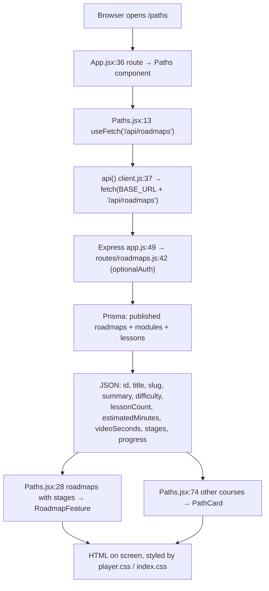

1. **Route.** `/paths` matches `<Route path="paths" element={<Paths />} />` (`client/src/App.jsx:36`).
2. **Load.** `Paths` calls `useFetch('/api/roadmaps')` (`client/src/pages/Paths.jsx:13`). While loading, it shows a skeleton (`:31`, `PageSkeleton` from `client/src/components/States.jsx:14`).
3. **Request.** `api()` sends `GET /api/roadmaps`. In development Vite forwards it to `http://localhost:4000` (`client/vite.config.js:9`–`:12`); in production `VITE_API_URL` points it at Render (`client/src/api/client.js:3`).
4. **Server.** Express routes `/api/roadmaps` to `server/src/routes/roadmaps.js` (`server/src/app.js:49`). The list handler (`roadmaps.js:42`) uses `optionalAuth`: anyone can view, and a signed-in student also gets progress. It only returns paths the viewer may see (`roadmapVisibilityWhere`, `server/src/services/learning.js:263`): students and guests see published paths only.
5. **Response.** Each path includes `stages` when it is a staged roadmap, and `videoSeconds` (total video) separate from `estimatedMinutes`.
6. **Render.** Paths with stages become a featured `RoadmapFeature` (`Paths.jsx:41`); the rest become `PathCard`s (`:74`). Search and level filters run in the browser (`Paths.jsx:19`).
7. **Errors.** If the request fails, `ErrorState` shows the message with a Retry button (`Paths.jsx:66`); no matches show `EmptyState` (`:68`).

### Concepts not used, or handled differently

| You might expect | This project |
| --- | --- |
| Server-side rendering (Next.js etc.) | Not used. The server returns JSON only; the browser renders everything. |
| TypeScript | Not used; plain JavaScript. |
| A CSS framework (Tailwind, Bootstrap) | Not used; hand-written CSS with custom properties. |
| A state library (Redux, Zustand) | Not used; React state, context and `useFetch`. |
| Cookies and server sessions | Not used for sign-in. A JWT is kept in `localStorage` and sent in the `Authorization` header. |
| GraphQL | Not used; a REST-style JSON API. |
| Automated tests | Not present in the repository. |
| Light mode | Removed; the site is dark only. |

---

## 5. Frontend details

### Page and component structure

| Area | Pages (`client/src/pages/`) | Notes |
| --- | --- | --- |
| Public | `Home`, `Paths`, `PathDetail`, `RoadmapPrint`, `Auth` (`Login`, `Register`), `PasswordReset` (`ForgotPassword`, `ResetPassword`), `VerifyCertificate`, `NotFound` | Routes in `App.jsx:35`–`:43` |
| Signed in | `CoursePlayer` (course home and lessons), `BlockQuiz`, `Lesson` (older non-sequential lesson page), `Dashboard`, `Bookmarks`, `Profile`, `Certificates`, `Certificate` | `App.jsx:45`–`:55` |
| Instructor/admin | `manage/ManageHome`, `ManageRoadmap`, `LessonEditor`, `RoadmapForm`, `QuizForm`, `BlockBank` | `App.jsx:57`–`:63` |
| Admin | `admin/AdminUsers`, `admin/AdminSystem` | `App.jsx:65`–`:68` |

Important components (`client/src/components/`):

| Component | Job |
| --- | --- |
| `Layout.jsx` | Skip link, header with navigation and mobile menu, `<main>`, footer, background animation |
| `States.jsx` | `Loading`, `PageSkeleton`, `ErrorState`, `EmptyState`, `Alert` (`:4`, `:14`, `:30`, `:47`, `:58`) |
| `RequireAuth.jsx` | Redirects to sign-in, or shows "not allowed", for protected routes |
| `RoadmapMap.jsx` | The winding-road roadmap; milestone states come from the course outline API (`buildMilestones`, `:49`) |
| `RoadmapFeature.jsx`, `RoadmapDownload.jsx` | Featured roadmap on `/paths`; PDF download and print links |
| `VideoPlayer.jsx` | YouTube or uploaded video; reports watched intervals (`createTracker`, `:31`) |
| `CheckpointCard.jsx` | An in-video question (answer, retry, rewatch) |
| `QuizCard.jsx`, `AnswerInput.jsx` | Question inputs for practice and exams |
| `VideoUploadDialog.jsx` | Instructor video upload with progress |
| `Markdown.jsx`, `CodeBlock.jsx` | Lesson text and code samples |
| `MatrixRain.jsx` | The animated background |

### Routing details

- `BrowserRouter` (`client/src/main.jsx:16`) uses real addresses such as `/paths/foo`. Hosting must therefore send every address to `index.html`: `client/vercel.json:6` (Vercel), `client/netlify.toml:9`–`:12` (Netlify), `client/nginx.conf:20`–`:22` (Docker).
- After sign-in, the user returns to the page they wanted: `RequireAuth` saves it (`RequireAuth.jsx:14`) and the login page navigates back (`client/src/pages/Auth.jsx:63`).

### Styling and responsive design

- **Tokens** on `:root` (`index.css:6`).
- **Mobile first** with breakpoints such as `@media (min-width: 640px)` (`index.css:162`), `960px` (`:756`) and phone overrides like `(max-width: 560px)` (`:1518`). The roadmap switches to a single column with the road on the left below 760px (`player.css`, section "Phones: the road runs down the left edge").
- The header becomes a toggle menu on small screens (`Layout.jsx:124`–`:127`).

### Accessibility (as implemented)

| Feature | Where |
| --- | --- |
| Skip link to main content | `Layout.jsx:79`, styles `index.css:186` |
| Visible keyboard focus | `:focus-visible` (`index.css:111`) |
| Screen-reader-only text | `.sr-only` (`index.css:121`) |
| Landmarks and labelled navigation | `Layout.jsx:82`, `:91`, `:135`, `:148` |
| Menu button state | `aria-expanded`, `aria-controls` (`Layout.jsx:125`–`:126`) |
| Form errors tied to fields | `aria-invalid` (`client/src/pages/Auth.jsx:23`, `:158`, `:178`) |
| Announced notifications | Toasts in `role="status" aria-live="polite"` (`client/src/context/ToastContext.jsx:36`) |
| Roadmap is a real ordered list; current step marked | `aria-current="step"` in `RoadmapMap.jsx` |
| Reduced motion | `useReducedMotion` (`client/src/lib/useReducedMotion.js`); the rain shows a still frame (`MatrixRain.jsx:93`); CSS `@media (prefers-reduced-motion: reduce)` (`index.css:2530`) |
| Printing | `@media print` (`index.css:2767`, and the print-page rules in `player.css`) |

No automated accessibility audit is part of the repository; these are code features, not a compliance certificate.

### The background animation

`MatrixRain` (`client/src/components/MatrixRain.jsx`) draws falling characters on two canvases. It is **not rendered** on study pages: `STUDY_PATHS = /^\/(learn|lessons)\//` (`:83`, used at `:87`). It stops when the tab is hidden and shows a still frame when reduced motion is requested (`:93`). There is no stop button.

### Talking to the backend

- **Base address:** `VITE_API_URL` at build time (`client/src/api/client.js:3`). Empty in development, so requests go to the Vite dev server, which proxies `/api` and `/health` to `http://localhost:4000` (`client/vite.config.js:9`–`:12`).
- **Token:** stored under the key `codepath.token` in `localStorage` (`client.js:7`) and sent as `Authorization: Bearer <token>` (`client.js:40`).
- **Session check on load:** if a token exists, `AuthProvider` calls `GET /api/auth/me` (`client/src/context/AuthContext.jsx:12`).
- **Expired session:** a 401 response with a token clears it and fires `codepath:unauthorized` (`client.js:61`–`:64`), which signs the user out in the UI (`AuthContext.jsx:18`–`:22`).
- **Direct file links:** `apiUrl(path)` builds absolute links for things the browser opens itself, such as the roadmap PDF (`client.js:6`, `client/src/components/RoadmapDownload.jsx`).

### Loading, errors, forms and feedback

| Situation | Implementation |
| --- | --- |
| Loading a page | `PageSkeleton` placeholder (`States.jsx:14`), or `Loading` spinner (`:4`) |
| Request failed | `ErrorState` with the server's message and an optional Retry (`States.jsx:30`) |
| Nothing to show | `EmptyState` (`States.jsx:47`) |
| Inline messages | `Alert`, whose `type` is `error`, `success` or `info` (`States.jsx:58`) |
| Pop-up notifications | `useToast()`; disappear after 4.5 s (`ToastContext.jsx:19`) |
| Form validation | Forms use `noValidate` and show the server's field errors: the API returns `details: [{ field, message }]` (`server/src/lib/errors.js:33`) and the form maps them to fields (`Auth.jsx:41`). Submit buttons are disabled while sending (`Auth.jsx:106`). |
| Network down | `ApiError` with code `NETWORK` and a friendly message (`client.js:53`) |
| Interface text | All wording lives in `client/src/i18n/en.js`; `t('key')` reads it and `fmt` formats numbers, dates and durations (`client/src/i18n/I18nContext.jsx:34` formats 90 minutes as "1 hr 30 min") |

---

## 6. Backend and API

### How the server starts

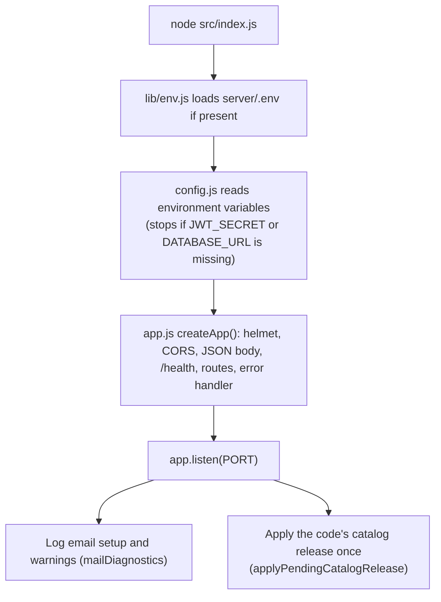

- `server/src/index.js:1` loads `.env` via `process.loadEnvFile()` (`server/src/lib/env.js:3`); real hosts provide variables directly.
- `server/src/config.js:13`–`:18` requires `JWT_SECRET` (at least 32 characters in production) and `DATABASE_URL`.
- `server/src/index.js:10`–`:20` starts listening, logs the email configuration, and applies the catalog release (see [section 7](#how-course-content-gets-into-the-database)).
- Graceful shutdown on `SIGTERM`/`SIGINT` closes the server and the database connection (`server/src/index.js:22`–`:32`).

### Middleware: what every request passes through

In order (`server/src/app.js`):

1. `trust proxy` so rate limits see the real client IP behind Render's proxy (`:21`).
2. `helmet()` security headers (`:24`).
3. `cors()` allows only origins listed in `CORS_ORIGIN`; requests without an Origin (health checks, curl) are allowed (`:25`–`:36`).
4. `express.json({ limit: '200kb' })` parses JSON bodies (`:37`).
5. `GET /health` checks the database with `SELECT 1` (`:39`–`:46`).
6. Route groups under `/api/...` (`:48`–`:56`).
7. `notFoundHandler`, then `errorHandler` (`:58`–`:59`).

**Errors.** Handlers simply `throw`; Express 5 passes thrown errors (including from `async` functions) to `errorHandler` (`server/src/lib/errors.js:31`), which returns one consistent shape: `{ "error": { "code", "message", "details" } }`. Zod validation errors become `400 VALIDATION_ERROR` with per-field details; Prisma "duplicate" becomes `409 CONFLICT`; anything unexpected is logged and returned as a generic `500` (`errors.js:32`–`:65`).

**Validation.** Every handler parses its input with a Zod schema, for example `registerSchema.parse(req.body)` (`server/src/routes/auth.js:36`). Shared schemas live in `server/src/lib/validation.js` (UUID, slug, URL, difficulty).

**Authentication middleware** (`server/src/middleware/auth.js`):

| Function | Behavior |
| --- | --- |
| `requireAuth` (`:46`) | Needs a valid `Bearer` token; loads the user from the database on every request, so role changes apply immediately (`:26`). |
| `optionalAuth` (`:54`) | Uses the token if valid, otherwise continues as a guest. |
| `requireRole(...roles)` (`:67`) | 403 if the user's role is not listed. |
| `signToken` (`:16`) | Creates a JWT with the user id and `tokenVersion`; increasing `tokenVersion` in the database revokes all older tokens (`:40`). |

**Rate limits** (per IP): sign-in and sign-up 30 per 15 min (`routes/auth.js:14`); reset requests 5 per 15 min (`routes/auth.js:104`) and at most 3 emails per account per hour (`:100`); reset attempts 20 per 15 min (`:112`); admin test email and catalog apply 5 per hour (`admin.js`).

### API endpoints

All paths are relative to the API origin. "Auth" means a valid token is required; "Optional" means the response is richer when signed in. Derived from `router.get/post/...` calls in `server/src/routes/`.

**Health and auth** (`server/src/app.js`, `server/src/routes/auth.js`)

| Method & path | Auth / role | Purpose |
| --- | --- | --- |
| `GET /health` | None | `{ status, database }`; 503 if the database is unreachable (`app.js:39`) |
| `POST /api/auth/register` | None | Create a student account; returns `{ token, user }` (`routes/auth.js:35`) |
| `POST /api/auth/login` | None | Returns `{ token, user }`; same error for wrong email or password (`routes/auth.js:48`) |
| `GET /api/auth/me` | Auth | Current user (`routes/auth.js:60`) |
| `PATCH /api/auth/me` | Auth | Change name or password (current password required); returns a fresh token after a password change (`routes/auth.js:75`) |
| `POST /api/auth/forgot-password` | None | Always the same reply; emails a reset link if the account exists (`routes/auth.js:160`) |
| `POST /api/auth/reset-password/verify` | None | Checks a reset token is usable (`routes/auth.js:196`) |
| `POST /api/auth/reset-password` | None | Sets the new password; signs out all devices (`routes/auth.js:207`) |

**Catalog and course player** (`roadmaps.js`, `courses.js`)

| Method & path | Auth / role | Purpose |
| --- | --- | --- |
| `GET /api/roadmaps?q=&featured=` | Optional | Visible paths with counts, estimated time, video total, stages, progress (`roadmaps.js:42`) |
| `GET /api/roadmaps/:slug` | Optional | One path with modules, lessons, lock status; may issue a certificate (`roadmaps.js:117`) |
| `GET /api/courses/:slug/outline` | Optional | Course player outline: lesson states, video times, quiz states, next step, stage details (`courses.js:54`) |
| `GET /api/courses/:slug/handout` | None | Roadmap data for the print page (published staged roadmaps only) (`courses.js:29`) |
| `GET /api/courses/:slug/roadmap.pdf` | None | The downloadable roadmap PDF (`courses.js:35`) |
| `GET /api/courses/modules/:id/quiz` | Auth | Block exam overview: locks, attempts, best score (`courses.js:286`) |
| `POST /api/courses/modules/:id/quiz/attempts` | Auth | Start an exam (`{ mode: 'EXAM' }`) or skip test (`{ mode: 'TEST_OUT' }`); returns questions without answers (`courses.js:293`) |
| `POST /api/courses/quiz-attempts/:id/submit` | Auth | Grade answers; returns score, pass/fail, explanations (`courses.js:302`) |
| `GET /api/courses/quiz-attempts/:id` | Auth | Review a submitted attempt (`courses.js:315`) |

**Lessons and questions** (all need Auth: `lessons.js:19`, `quizzes.js:11`)

| Method & path | Purpose |
| --- | --- |
| `GET /api/lessons/:id` | Lesson content, video details, checkpoints (answers hidden) (`lessons.js:41`) |
| `PUT /api/lessons/:id/progress` | Mark complete; in sequential courses only when requirements are met (`lessons.js:157`) |
| `POST /api/lessons/:id/video-progress` | Report watched interval; may complete the lesson (`lessons.js:198`) |
| `POST /api/lessons/:id/activity` | Heartbeat for active learning time (`lessons.js:222`) |
| `PUT` / `DELETE /api/lessons/:id/bookmark` | Add or remove a bookmark (`lessons.js:230`, `:241`) |
| `POST /api/quizzes/:id/attempts` | Answer a question; reveals the answer only when allowed (`quizzes.js:23`) |
| `GET /api/quizzes/:id/attempts` | Your recent answers to a question (`quizzes.js:70`) |

**My account** (all need Auth: `me.js:20`)

| Method & path | Purpose |
| --- | --- |
| `GET /api/me/dashboard?tz=` | Progress per path, next lessons, recent activity, streak, topic mastery (`me.js:97`) |
| `GET /api/me/bookmarks` | Bookmarked lessons (active paths only) (`me.js:280`) |
| `GET /api/me/weaknesses` | Topics below 70% with review lessons (`me.js:315`) |
| `POST /api/me/weaknesses/:tag/review` | Confirm you reviewed a topic (`me.js:319`) |
| `GET /api/me/certificates`, `GET /api/me/certificates/:id` | Your certificates (`me.js:340`, `:351`) |
| `PUT /api/me/certificates/:id/sharing` | Turn the public verification link on or off (`me.js:362`) |
| `GET /api/certificates/verify/:code` | **Public**: verify a shared certificate (`routes/certificates.js:12`) |

**Content management** (Auth + `INSTRUCTOR` or `ADMIN`: `manage.js:16`; editing an existing path also needs to be its assigned instructor or an admin, `manage.js:27`)

| Method & path | Purpose |
| --- | --- |
| `GET`/`POST /api/manage/roadmaps`, `GET`/`PATCH /api/manage/roadmaps/:id` | List, create, view and edit paths (`manage.js:259`–`:340`) |
| `DELETE /api/manage/roadmaps/:id` | Delete a path (**ADMIN only**, `manage.js:349`) |
| `POST /api/manage/roadmaps/:id/modules`, `PATCH`/`DELETE /api/manage/modules/:id`, `POST .../move` | Modules (`manage.js:356`–`:404`) |
| `POST /api/manage/modules/:id/lessons`, `GET`/`PATCH`/`DELETE /api/manage/lessons/:id`, `POST .../move` | Lessons; adding a YouTube video looks up its runtime (`manage.js:412`–`:472`) |
| `POST /api/manage/lessons/:id/quizzes`, `PATCH`/`DELETE /api/manage/quizzes/:id`, `PATCH .../review` | Questions and review flags (`manage.js:485`–`:528`) |
| `GET /api/manage/topics` | Topic list (`manage.js:519`) |
| `GET /api/manage/modules/:id/block-questions`, `PATCH /api/manage/block-questions/:id/review` | Exam question bank (`manage.js:536`, `:546`) |
| `GET /api/manage/storage` | Is video storage configured; size and type limits (`manage.js:564`) |
| `POST /api/manage/lessons/:id/video-uploads` | Start an upload; returns a pre-signed PUT URL (`manage.js:583`) |
| `POST /api/manage/video-uploads/:id/complete`, `.../abort` | Finish or cancel an upload (`manage.js:627`, `:658`) |
| `DELETE /api/manage/lessons/:id/video-upload` | Remove an uploaded video (`manage.js:669`) |

**Administration** (Auth + `ADMIN`: `admin.js:15`)

| Method & path | Purpose |
| --- | --- |
| `GET /api/admin/stats` | Counts of users, paths, lessons, questions, attempts (`admin.js:26`) |
| `GET /api/admin/users`, `PATCH /api/admin/users/:id/role`, `DELETE /api/admin/users/:id` | User management (`admin.js:45`–`:106`) |
| `PUT /api/admin/roadmaps/:id/instructors` | Assign instructors to a path (`admin.js:114`) |
| `GET /api/admin/system`, `POST /api/admin/system/test-email` | Email/storage status; send yourself a test email (`admin.js:140`, `:158`) |
| `GET /api/admin/catalog`, `POST /api/admin/catalog/sync` | Preview and apply a catalog update (body `{ "confirm": true }`) (`admin.js:177`, `:184`) |

### Flow: sign-in

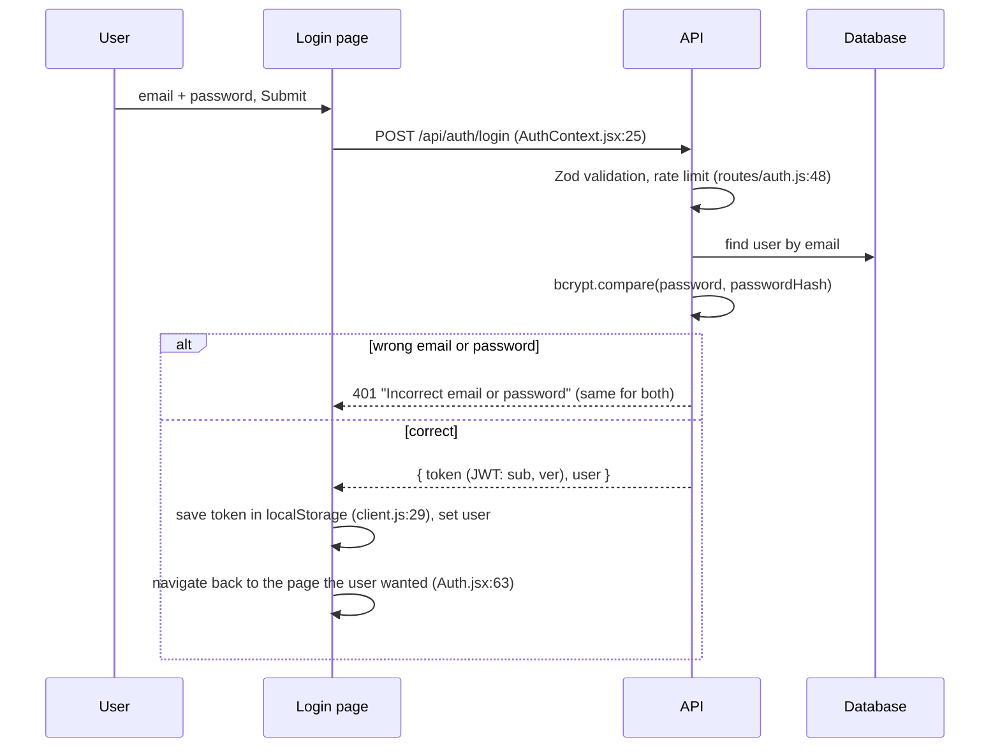

Every later request sends the token; `requireAuth` verifies its signature and that its `ver` still equals the user's `tokenVersion` (`middleware/auth.js:27`–`:44`).

### Flow: browsing a course

Signed out or in, `/paths/:slug` loads `GET /api/roadmaps/:slug` and, for staged roadmaps, `GET /api/courses/:slug/outline` to draw the road map (`client/src/pages/PathDetail.jsx`). Opening a course (`/learn/:slug`) requires sign-in and loads the outline (`client/src/pages/CoursePlayer.jsx:923`). The outline's lesson states (`LOCKED`, `AVAILABLE`, `IN_PROGRESS`, `COMPLETED`) are computed on the server (`server/src/routes/courses.js`).

### Flow: lesson progress and the 80% rules

The course player enforces these rules on the **server**; the interface only shows them.

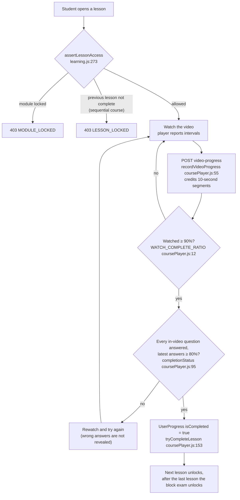

- **Module locks** (`computeModuleAccess`, `server/src/services/learning.js:148`): a module stays locked until the modules before it have every lesson complete, no "needs review" topics, and a passed block exam (unless skipped with a skip test).
- **Lesson order:** in sequential courses, a lesson opens only after the previous one is complete (`learning.js:294`–`:308`).
- **Video watching:** the player reports what was actually played; the server credits 10-second segments and ignores implausible jumps (`server/src/services/coursePlayer.js:11`–`:14`, `:55`).
- **In-video questions:** the latest answer to each counts; the pass mark is the course's `checkpointPassPercent` (80 for catalog courses). A wrong answer in a gated course does not reveal the correct answer (`server/src/routes/quizzes.js:31`–`:35`, `:55`–`:58`).
- **Completing a lesson** cannot be undone in sequential courses (`server/src/routes/lessons.js:164`–`:165`).

### Flow: block exams and skip tests

1. **Access** (`blockQuizAccess`, `coursePlayer.js:269`): an exam opens only after every lesson in the module is complete and any linked courses are finished. A **skip test** (`TEST_OUT`) is offered only where the module allows it, at most 2 tries (`MAX_TEST_OUT_ATTEMPTS`, `coursePlayer.js:264`).
2. **Start** (`startBlockQuiz`, `:359`): picks random questions from the module's bank (`quizQuestionCount`, at least 10 in the catalog), creates a `BlockQuizAttempt`, and returns questions **without** answers.
3. **Submit** (`submitBlockQuiz`, `:396`): grades on the server, computes the percent, `passed = percent >= quizPassPercent` (80 in the catalog), saves answers, and returns explanations. A double submit cannot grade twice (`:435`–`:439`).
4. **Retry:** start a new attempt; every attempt is kept.

### Flow: instructor video upload

The video file goes **directly from the browser to object storage**; the API server never receives the file.

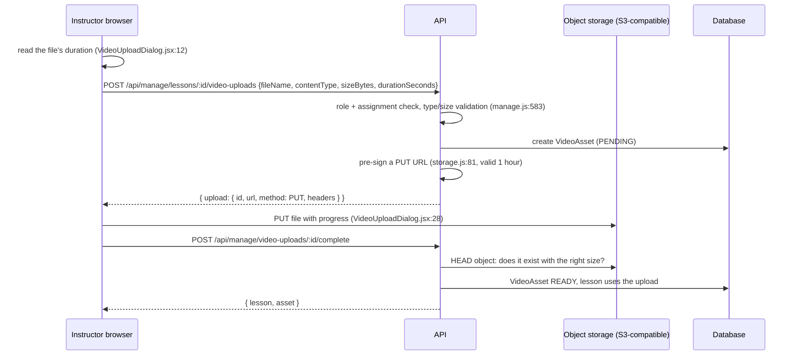

Students later get a short-lived signed playback URL (`presignPlayback`, `server/src/lib/storage.js:88`, valid 6 hours). If storage is not configured, the start step returns `STORAGE_NOT_CONFIGURED` (`manage.js`).

### Flow: password reset

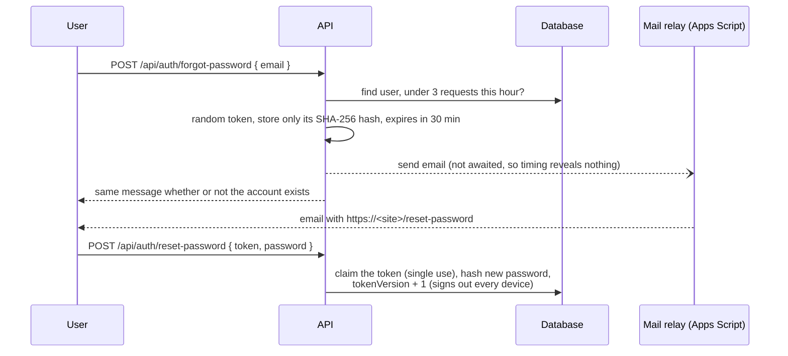

References: request `server/src/routes/auth.js:160`–`:194` (hash at `:178`); reset `:207`–`:229` (sign-out at `:221`); the token is in the URL **fragment** (`#token=`), which browsers do not send to servers. The mail transport is chosen in `server/src/lib/mailer.js:34` (Apps Script relay first, then Resend, Brevo, SMTP; in development without any, emails are saved to `server/.dev-mail/`).

---

## 7. Database and data flow

### Overview

PostgreSQL, accessed only through Prisma. `server/prisma/schema.prisma` defines 23 models and 8 enums. Two connection strings are used (`schema.prisma:5`–`:9`): `DATABASE_URL` for the app (may be a pooled URL) and `DIRECT_URL` for migrations.

### Core tables and relationships

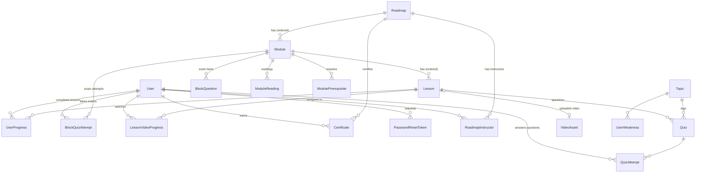

| Table (model) | Holds | Notes |
| --- | --- | --- |
| `User` (`schema.prisma:69`) | Accounts | Unique email; `passwordHash` (bcrypt), `role`, `tokenVersion` for revoking tokens |
| `PasswordResetToken` (`:95`) | Reset links | Only a SHA-256 **hash** of the token, `expiresAt`, `usedAt` |
| `Roadmap` (`:107`) | A learning path or course | `slug` (URL), `isPublished`, `isSequential`, `checkpointPassPercent`, `catalogKey`/`catalogVersion` for built-in courses |
| `Module` (`:152`) | A block/stage inside a path | Ordered; exam settings; stage details (outcomes, practice, specialties) |
| `Lesson` (`:268`) | A lesson | Markdown `content`; video (`youtubeId`, `videoStart`/`videoEnd` clip, `videoDurationSeconds` full runtime) or uploaded file |
| `Quiz` (`:365`) | A question in a lesson | `placement` `CHECKPOINT` (in-video, `triggerSeconds`) or `LESSON` (practice); `correctAnswer` is never sent before an attempt |
| `BlockQuestion` (`:210`), `BlockQuizAttempt` (`:236`) | Exam bank and attempts | `mode` `EXAM` or `TEST_OUT`; score and `passed` |
| `UserProgress` (`:395`) | Lesson completion | One row per user and lesson |
| `QuizAttempt` (`:409`) | Every answer | Used for scores and weak topics |
| `LessonVideoProgress` (`:328`) | Watched segments | Completion at 90% |
| `UserWeakness` (`:424`), `Topic` (`:358`) | Topic accuracy | Below 70% → needs review |
| `LessonActivity` (`:446`) | Active learning time | From heartbeats |
| `Certificate` (`:462`) | Earned certificates | Title snapshot kept even if the path is deleted (`roadmapId` becomes null) |
| `VideoAsset` (`:306`) | Uploaded files | Status `PENDING`/`READY`/`FAILED`/`REPLACED` |
| `Bookmark` (`:489`), `LessonResource` (`:345`), `ModuleReading` (`:190`), `ModulePrerequisite` (`:258`), `RoadmapInstructor` (`:141`) | Supporting data | |
| `CatalogLock` (`:502`), `CatalogRelease` (`:510`) | Catalog update safety | Lease lock; record of applied releases |

**Deleting is dangerous.** Most learner records are deleted automatically with their parent (`onDelete: Cascade`, e.g. `UserProgress` at `schema.prisma:402`–`:403`). Deleting a lesson deletes its progress, answers and bookmarks. This is why retired courses are unpublished instead of deleted.

### How authentication and progress connect to records

- A JWT contains only the user id (`sub`) and token version (`ver`) (`middleware/auth.js:17`). The server loads `User` on each request.
- Progress always uses `req.user.id`: completing a lesson upserts `UserProgress(userId, lessonId)` (`server/src/services/coursePlayer.js:158`–`:161`); answers insert `QuizAttempt`; exams insert `BlockQuizAttempt`; certificates are issued when a path is complete (`server/src/services/certificates.js:88`).
- Unique constraints stop duplicates, for example one progress row per user and lesson (`@@unique([userId, lessonId])`, `schema.prisma:405`).

### Migrations

Six migrations in `server/prisma/migrations/`, applied in name order. Production has exactly these six (**verified**).

| Migration | Adds |
| --- | --- |
| `20261022000000_init` | Base tables |
| `20261023000000_password_reset` | `PasswordResetToken` table, `User.tokenVersion` |
| `20261024000000_certificates` | `Certificate` and `LessonActivity` tables |
| `20261027000000_course_player_videos` | Video lessons, block exams, uploads |
| `20261028000000_cyber_roadmap` | Roadmap and stage fields, `CatalogLock` table; unpublishes the four programming paths |
| `20261029000000_catalog_release` | `CatalogRelease` table |

Development creates new migrations with `npm run db:migrate` (`prisma migrate dev`). Production applies them with `prisma migrate deploy`, which only runs migrations not yet applied.

### How course content gets into the database

The cybersecurity courses are **data in code**: `server/src/catalog/*.js` (one file per course; `index.js` lists them). They reach the database through a **catalog sync** (`server/src/services/courseCatalog.js:393`), which matches items by `catalogKey` so learner progress on unchanged lessons is kept.

A sync runs only on purpose:

1. **Named release (default).** `CATALOG_RELEASE` in `server/src/catalog/index.js` names the update this code ships. On the first startup that sees a new name, the API applies it once and records it in `CatalogRelease` (`courseCatalog.js:343`). It **refuses** if the update would delete anything with learner history (`catalogRemovals`, `:272`). Turn it off with `CATALOG_AUTO_RELEASE=false` (`server/src/config.js:44`).
2. **Admin → System → Course catalog** (preview, then apply).
3. **CLI:** `npm --prefix server run catalog:sync` (dry run) and `-- --apply`.

All three take a 10-minute lease row (`CatalogLock`, `courseCatalog.js:376`–`:390`) so two runs never overlap. A course is only updated when its `version` in the catalog file is higher than the stored `catalogVersion`.

Video runtimes for catalog videos come from `server/src/catalog/video-runtimes.json`, verified from each video's YouTube page (see `docs/video-runtime-audit.md`).

---

## 8. Setting up and working on the project

### Prerequisites (from the repository)

- **Node.js 20.19 or newer** (`client/package.json:6`, `server/package.json:8`); Node 22 matches production (`render.yaml:15`).
- **npm** (comes with Node).
- **PostgreSQL**: a local server, a free Neon project, or Docker (`docker-compose.yml:8`–`:21`).
- **Git**.
- Optional: Docker Desktop for the all-in-one setup.

### Steps

From the repository root:

```bash
# 1. Install dependencies for both apps (also runs "prisma generate")
npm run install:all

# 2. Create the server's local settings file from the template
cp server/.env.example server/.env
# then edit server/.env: at least DATABASE_URL, DIRECT_URL and JWT_SECRET (see the table below)

# 3. Create the database tables (applies the existing migrations; never resets anything)
npm run db:deploy

# 4. Optional: demo accounts (set DEMO_PASSWORD in server/.env first) and sample data
npm run db:seed

# 5. Start the API (terminal 1) — on first start it also loads the cybersecurity courses (catalog release)
npm run dev:server          # http://localhost:4000, check http://localhost:4000/health

# 6. Start the website (terminal 2)
npm run dev:client          # open http://localhost:5173

# 7. Optional: make yourself an admin (password: at least 10 characters with letters and numbers)
npm run create-admin -- --email you@example.com --name "Your Name" --password "<a password>"
```

> **Use your own database for development, not production.** Point `server/.env` at a local PostgreSQL, Docker, or a **Neon branch** (a copy of the database), never at the production database. Two reasons, both from the code:
> - Starting the API applies the code's catalog release to whatever database it is connected to (`server/src/index.js:17`–`:19`). A developer running newer code against production would change live course content from their own computer. If you must connect to a shared database, set `CATALOG_AUTO_RELEASE=false` in `server/.env` (`server/src/config.js:44`).
> - `npm run db:migrate` runs `prisma migrate dev`, which can offer to **reset (erase) the database** when it finds differences. Use it only on your own development database, and only when you change `schema.prisma`. To just apply existing migrations, use `npm run db:deploy`.

Notes:

- The client needs **no** `.env` locally: with `VITE_API_URL` empty, Vite proxies `/api` to port 4000 (`client/.env.example:2`, `client/vite.config.js:9`–`:12`).
- `db:seed` creates the four sample programming paths **unpublished** (`server/prisma/seed.js:46`) and demo accounts only when `DEMO_PASSWORD` is set and `NODE_ENV` is not `production` (`seed.js:134`–`:149`). It does **not** create the cybersecurity courses; those come from the catalog release when the API starts. **Never run `db:seed` against production, and never with `SEED_RESET=true` there**: the sample paths are the four retired courses, which hold real learner history in production, and a reset deletes that history.
- Without email settings in development, reset emails are written to `server/.dev-mail/` as HTML files instead of being sent (`server/src/lib/mailer.js`).
- **Docker alternative:** copy `.env.docker.example` to `.env`, set `POSTGRES_PASSWORD` and `JWT_SECRET`, run `docker compose up --build`, then `docker compose exec server npm run db:seed`; open `http://localhost:8080` (`docker-compose.yml:1`–`:6`).

### Environment variables

**Server** (`server/.env` locally; the host's settings in production). Source: `server/src/config.js` and `server/.env.example`.

| Name | Required | Purpose |
| --- | --- | --- |
| `DATABASE_URL` | **Yes** | Database connection used by the app (Neon: pooled URL) |
| `DIRECT_URL` | **Yes** for migrations | Direct connection for `prisma migrate` |
| `JWT_SECRET` | **Yes** | Signs sign-in tokens; ≥ 32 characters in production (`config.js:14`) |
| `NODE_ENV` | Production: `production` | Enables production rules (e.g. email required, secret length) |
| `PORT` | No (default 4000) | Port the API listens on (hosts usually set it) |
| `CORS_ORIGIN` | Production: **yes** | Comma-separated website origins allowed to call the API (`config.js:21`) |
| `APP_URL` | Recommended | Website address used in reset-email links (falls back to the first `https` CORS origin in production, `config.js:28`–`:32`) |
| `JWT_EXPIRES_IN` | No (`7d`) | Token lifetime |
| `BCRYPT_ROUNDS` | No (12) | Password hashing cost |
| `RESET_TOKEN_MINUTES` | No (30) | Reset link lifetime |
| `MAIL_APPS_SCRIPT_URL`, `MAIL_APPS_SCRIPT_SECRET` | For email in production | Google Apps Script mail relay (`server/apps-script/README.md`) |
| `RESEND_API_KEY` / `BREVO_API_KEY` / `SMTP_*`, `MAIL_FROM` | Alternatives | Other email transports |
| `STORAGE_ENDPOINT`, `STORAGE_REGION`, `STORAGE_ACCESS_KEY_ID`, `STORAGE_SECRET_ACCESS_KEY`, `STORAGE_BUCKET`, `STORAGE_FORCE_PATH_STYLE`, `VIDEO_MAX_MB` | For video uploads | S3-compatible storage (`config.js:62`–`:70`); `AWS_*` names are also accepted |
| `CATALOG_AUTO_RELEASE` | No (on) | `false` stops the automatic one-time catalog release |
| `ADMIN_EMAIL`, `ADMIN_NAME`, `ADMIN_PASSWORD` | Only for `create-admin` | Remove after use |
| `DEMO_PASSWORD` | Only for seeding | Demo accounts in development |
| `SEED_RESET` | Only for seeding | `true` recreates sample paths and **deletes their learner progress**; never use against production |

**Website** (set on the host at build time):

| Name | Purpose |
| --- | --- |
| `VITE_API_URL` | API origin without a trailing slash, e.g. `https://<your-api>.onrender.com`. Baked into the JavaScript when it is built (`client/src/api/client.js:3`). |

Generate a secret with: `node -e "console.log(require('crypto').randomBytes(48).toString('hex'))"` (`server/.env.example:10`). Never commit `.env` files; they are ignored by Git (`.gitignore`).

### Available checks

There are no automated tests or linters. Run these before every release:

| Command | Checks |
| --- | --- |
| `npm --prefix client run build` | The website compiles |
| `npm --prefix server run check:catalog` | Course catalog: answers match options, questions inside clips, ≥ 80% pass marks, ≥ 10 exam questions, links are https, video runtimes consistent (`server/scripts/check-catalog.js`) |
| `npm --prefix server run check:videos` | Re-reads every catalog video's runtime from YouTube (network; YouTube may rate-limit) |
| `npx prisma validate` (in `server/`) | The schema is valid |
| `curl http://localhost:4000/health` | API and database reachable |

---

## 9. Making the project live

### Current production setup

| Piece | Where | Status |
| --- | --- | --- |
| Website | Vercel project, `https://code-path-cloud.vercel.app`, built from `client/` | **Verified live** |
| API | Render web service `https://codepath-api-1u5o.onrender.com`, from `server/` | **Verified live** |
| Database | Neon PostgreSQL | **Verified** (migration history) |
| Deploy trigger | Pushing to `main` on GitHub deploys both (GitHub shows a Vercel status and a Render deployment per commit) | **Verified** from GitHub deployment records |
| Email relay, video storage | Configured on Render? | **Not verified** |

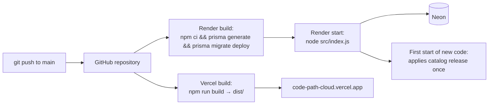

### Conflicting or outdated configuration and documents

The repository contains several hosting descriptions. Only the Vercel + Render + Neon setup is what production uses (verified above). Everything else is an alternative or out of date:

| Item | What it says | What is actually true | What to do |
| --- | --- | --- | --- |
| Example API address in `client/.env.example:1`, the comment at `client/src/api/client.js:2`, and the README's Vercel step | `https://codepath-api.onrender.com` | **Verified live: a different, unrelated service.** Its `/health` answers `{"status":"ok","version":"0.3.0"}` and `/api/roadmaps` returns a non-Express 404. This project's API is `https://codepath-api-1u5o.onrender.com`. | Never copy the example. Use your own service's URL from the Render dashboard. |
| `render.yaml:5` service name | `codepath-api` | The live hostname is `codepath-api-1u5o`; Render adds a suffix when a name is taken. GitHub's deployment records name the service `codepath-api`. | Whether the service was created from this Blueprint or by hand: **not verified** (Render → service → Settings). |
| README "Seed the data and create the admin from Render's **Shell**" | Run `npm run db:seed` in production | Outdated. The seed no longer provides course content (the catalog release does), skips demo accounts in production (`server/prisma/seed.js:139`), and with `SEED_RESET=true` deletes learner history in the retired paths. Shell availability on Render's free plan: **not verified**. | Don't seed production. Create the admin with `create-admin` from a machine with `DATABASE_URL` set. |
| README alternatives: Supabase, Railway, Netlify | Supported options | The code and configs support them (`client/netlify.toml`, Supabase notes in `server/.env.example:3`), but production uses none of them. `client/netlify.toml` is unused. | Use only if you move hosts. |
| Docker (`docker-compose.yml`, README "Deploying with Docker") | Run the whole platform | Sets `NODE_ENV=production` (`docker-compose.yml:34`) but no `APP_URL`, email or storage variables. Email is therefore disabled, uploads are unavailable, and the seed skips demo accounts. Migrations run when the container starts (`server/Dockerfile:12`), while Render runs them during the build (`render.yaml:9`). | Fine for a local trial; add the missing variables before using it anywhere real. |
| `render.yaml:38` | `STORAGE_REGION` fixed to `us-east-2` | Must match your bucket's region. | Change it if your storage is elsewhere. |
| README Features | "four ready-made paths (Frontend, Backend…)", animation "can be paused", demo instructor "assigned to the Frontend path" | Those paths are retired (unpublished), and the pause button was removed (`client/src/components/MatrixRain.jsx`). | Treat the README features list as partly outdated. |
| Root `package.json:5` | "a platform for learning programming" | The site is cybersecurity-only. | Cosmetic. |
| `CodePath-Cloud-Setup-Guide.docx` (repository root, last changed 23 Oct 2026) | Every developer connects to one shared Neon database and skips migrations; project folder "yasser"; lists libraries | It predates the catalog release: if that shared database is production (**not verified**; the document doesn't say), a developer starting newer code would apply catalog changes to production (see the [development database warning](#steps)). The folder name doesn't match this repository, and the library list misses pdfkit, the AWS S3 SDK and nodemailer. | Give developers their own database or a Neon branch, or at least `CATALOG_AUTO_RELEASE=false`; update or replace the document with [section 8](#8-setting-up-and-working-on-the-project). |
| `server/src/app.js:20` | Comment mentions "Render/Railway" | Harmless; the `trust proxy` setting suits any single proxy in front of the API. | None. |

### Step by step (from scratch, or to rebuild)

**A. Database (Neon)** — requires a Neon account (user action)

1. Create a Neon project and database.
2. Copy two connection strings: the **pooled** one (for `DATABASE_URL`) and the **direct** one (for `DIRECT_URL`) (`server/.env.example:3`–`:6`). Keep them secret.

**B. API (Render)** — requires a Render account (user action)

1. Create a **Web Service** from the GitHub repository, or a **Blueprint** from `render.yaml`.
2. Settings from `render.yaml`:
   - Root directory: `server` (`:7`)
   - Build command: `npm ci && npx prisma generate && npx prisma migrate deploy` (`:9`): migrations run on every deploy
   - Start command: `node src/index.js` (`:10`)
   - Health check path: `/health` (`:11`)
   - Plan: free (`:8`). The free plan sleeps when idle, so the first request after a pause can take up to a minute (Render behavior, **not verified** in this repository).
3. Environment variables (`render.yaml:12`–`:42`): `NODE_ENV=production`, `NODE_VERSION=22`, `JWT_SECRET` (generated), `DATABASE_URL`, `DIRECT_URL`, `CORS_ORIGIN=https://<your-site>` , `APP_URL=https://<your-site>`, email (`MAIL_APPS_SCRIPT_URL`, `MAIL_APPS_SCRIPT_SECRET`), storage (`STORAGE_*`).
4. Deploy, then open `https://<your-api>/health` and expect `{"status":"ok","database":"ok"}`.
5. Create the first admin from a machine with database access: set `DATABASE_URL` in your terminal and run `npm run create-admin -- --email ... --name ... --password ...`. (Render's free plan has no shell; **not verified** whether your plan has one.)

> Whether the live Render service uses exactly these settings is **not verified**. Check in the Render dashboard → your service → **Settings** (Build & Deploy, Root Directory) and **Environment**.

**C. Website (Vercel)** — requires a Vercel account (user action)

1. Import the GitHub repository; set the **Root Directory** to `client`.
2. `client/vercel.json` sets the framework (Vite), build command `npm run build`, output `dist`, and the rewrite so every address serves `index.html`.
3. Environment variable: `VITE_API_URL=https://<your-api>` (no trailing slash). Because Vite bakes it in at build time, **redeploy after changing it**.
4. Deploy and open the site.

**D. Connect them**

1. Put the website's exact origin (scheme + host, no path, no trailing slash) in the API's `CORS_ORIGIN`; add more with commas (e.g. preview URLs).
2. Put the same address in `APP_URL` so reset emails link to the live site.
3. Redeploy the API after changing variables (Render restarts the service).

**E. Email (password reset)** — requires a Google account (user action). Follow `server/apps-script/README.md`: deploy the script as a web app, set its Script Properties, then set `MAIL_APPS_SCRIPT_URL` and `MAIL_APPS_SCRIPT_SECRET` on Render. The startup log should show `[mail] mode=apps-script` with no `[mail] WARNING` lines (`server/src/index.js:12`–`:14`).

**F. Video uploads** — requires an S3-compatible bucket (user action). Set the `STORAGE_*` variables; check Admin → System → Video storage shows "Configured".

### How to verify the live site

| Check | Expected |
| --- | --- |
| `curl https://<api>/health` | `{"status":"ok","database":"ok",...}` |
| Open `https://<site>/paths` | The roadmap and courses load |
| Browser dev tools → Network on `/paths` | `GET https://<api>/api/roadmaps` returns 200 (not a CORS error) |
| `curl -H "Origin: https://<site>" -I https://<api>/api/roadmaps` | `access-control-allow-origin: https://<site>` |
| Admin → System | Email mode and storage status; send a test email |
| Render → Logs after deploy | `CodePath Cloud API listening on port ...`, `[mail] mode=...`, catalog release lines |

### Safe release checklist

1. `git pull` on `main`; make sure nobody pushed newer work.
2. Run the checks in [section 8](#available-checks); all must pass.
3. If the schema changed: the migration only **adds** things (no dropped columns or tables with data); test it on a copy (a Neon branch) first.
4. If course content changed: bump the course `version` and `CATALOG_RELEASE`; run `catalog:sync` as a dry run against a copy if possible.
5. No secrets in the diff (`git diff`), no `.env` files staged.
6. Push to `main`. Watch GitHub's commit status (Vercel) and the Render deploy.
7. After deploy: `/health`, the live site, Render logs (no errors, `[catalog] release ... applied; learner data unchanged` when a release ran).

### Rollback

- **Website:** Vercel → project → **Deployments** → choose the previous good deployment → **Promote to Production** (or "Instant Rollback"). Requires dashboard access.
- **API:** Render → service → **Events / Deploys** → **Rollback** to the previous deploy, or `git revert` the bad commit and push.
- **Database:** migrations are not rolled back automatically, and old code may not work with a newer schema. Prefer additive migrations so old code keeps working. To restore data, use Neon's restore/branch feature from a point in time before the change (Neon dashboard; plan limits **not verified**).
- **Catalog content:** catalog releases run once; to undo a content change, ship a new release with the corrected catalog. Never delete courses with learner history.

---

## 10. Maintenance and troubleshooting

### Add or change a page

1. Create `client/src/pages/MyPage.jsx` exporting a component (copy the structure of `Paths.jsx`).
2. Add a `<Route>` in `client/src/App.jsx`, inside `RequireAuth` if it needs sign-in.
3. Load data with `useFetch('/api/...')`; handle `loading` (`PageSkeleton`), `error` (`ErrorState`) and empty results (`EmptyState`).
4. Put all text in `client/src/i18n/en.js` and use `t('section.key')`.
5. Style with existing classes and tokens; add new rules to the matching CSS file.
6. If it is a study page and the background should stop, make sure its address matches `STUDY_PATHS` (`MatrixRain.jsx:83`).

### Add an API feature

1. Pick the route file by area (`server/src/routes/`), or create one and mount it in `server/src/app.js`.
2. Guard it: `requireAuth`, `optionalAuth`, `requireRole(...)`.
3. Validate input with a Zod schema; throw `badRequest`, `forbidden`, `notFound` from `server/src/lib/errors.js`.
4. Put business rules in `server/src/services/` so other routes can reuse them.
5. Never trust the browser: repeat permission and lock checks on the server.

### Change the database

1. Edit `server/prisma/schema.prisma`.
2. Run `npm run db:migrate` against **your own development database** and name the migration; commit the new folder in `server/prisma/migrations/`.
3. Prefer additive changes (new nullable columns, new tables). Removing or renaming a column with data needs a planned migration.
4. Deploying runs `prisma migrate deploy` automatically on Render (`render.yaml:9`).

### Change course content

Edit `server/src/catalog/<course>.js`, bump that course's `version`, change `CATALOG_RELEASE` in `server/src/catalog/index.js`, and run `npm --prefix server run check:catalog`. For a new YouTube video, run `npm --prefix server run check:videos -- --write` to record its runtime.

### Change a configuration setting

Add the variable to `server/src/config.js` (with a safe default), document it in `server/.env.example` (and `render.yaml` if Render needs it), then set it in the host's dashboard. Frontend settings must start with `VITE_` and need a rebuild.

### Common problems

| Symptom | Likely cause | How to investigate |
| --- | --- | --- |
| Website loads but lists are empty / "Could not reach the server" | API asleep (free plan), wrong `VITE_API_URL`, or CORS | Browser dev tools → Network; open `https://<api>/health`; check `VITE_API_URL` in Vercel → Settings → Environment Variables, then redeploy |
| API calls return 404 `{"detail":"Not Found"}` | `VITE_API_URL` was copied from the docs' example address, which is a different service | Set `VITE_API_URL` to your own Render URL in Vercel, then redeploy |
| Network tab shows a CORS error | Site origin missing from `CORS_ORIGIN` | Render → Environment; must match exactly (no trailing slash) |
| API won't start: "Environment variable ... is required" | Missing `DATABASE_URL` or `JWT_SECRET` (`config.js:8`) | Render → Logs; Render → Environment |
| "JWT_SECRET must be at least 32 characters" | Short secret in production (`config.js:15`) | Generate a new one |
| `/health` returns 503 `database: unreachable` | Database down, wrong URL, or Neon compute asleep | Neon dashboard → project → Monitoring; check `DATABASE_URL` |
| Deploy fails during build | Migration error or dependency install error | Render → Events → the failed deploy → logs; run `npx prisma migrate deploy` against a Neon branch |
| Reset email never arrives | Email not configured or relay error | Render logs: `[mail] mode=...` and `[mail] WARNING`; `Password reset email failed: ...`; Admin → System → Send test email |
| "Video storage is not configured" | `STORAGE_*` missing | Admin → System; Render → Environment |
| Reset link points to localhost | `APP_URL` / `CORS_ORIGIN` not set in production | Startup log line `reset-links=...` |
| A page 404s when refreshed on the live site | Missing single-page rewrite | `client/vercel.json:6` must be deployed with the site |
| New courses or changes don't appear | Catalog release not applied, or refused | Render logs for `[catalog] release ...`; Admin → System → Course catalog |
| Signed out unexpectedly | Token expired (7 days), password changed or reset (`tokenVersion`), or role/account changed | Expected behavior |

**Where logs are:** Render → service → **Logs** (API `console` output); Vercel → project → **Deployments** → a deployment → build logs (the website has no server logs); Neon → project → **Monitoring**; the browser's developer tools (Console, Network) for frontend errors.

### Security-sensitive areas

| Area | Why it matters | Where |
| --- | --- | --- |
| `JWT_SECRET` | Anyone with it can forge sign-ins | Host environment only; rotating it signs everyone out |
| Database URLs | Full data access | Host environment only |
| Password storage | bcrypt hashes only, never plain text | `routes/auth.js:40` |
| Reset tokens | Stored only as SHA-256 hashes; single-use; expire; generic replies | `routes/auth.js:160`–`:229` |
| Role checks | Must be on the server; the browser guard is cosmetic | `middleware/auth.js:67`, `RequireAuth.jsx:7` |
| Answers to questions | Never sent before an attempt | `server/prisma/schema.prisma:372`, `publicQuiz` in `learning.js:392` |
| Uploads | Type and size limits; storage keys use generated ids, never file names | `manage.js` upload section |
| Mail relay secret | Signs relay requests; leaking it lets someone send templated emails from the Gmail account | `server/apps-script/README.md` |
| Lesson content | Markdown rendered without raw HTML | `schema.prisma:273` comment, `client/src/components/Markdown.jsx` |
| Admin bootstrap | `ADMIN_PASSWORD` should be removed from the environment after use | `server/.env.example:69`–`:73` |

**Safe secret handling:** keep secrets only in `.env` (ignored by Git) and the host dashboards; never paste them into code, issues, logs or chat; use different secrets for development and production; rotate a secret immediately if it was exposed.

---

## 11. Study materials

### Suggested learning order

1. Read [section 2](#2-architecture) and draw the architecture diagram yourself from memory.
2. Run the project locally ([section 8](#8-setting-up-and-working-on-the-project)) and click through as a student.
3. Read `client/index.html`, `main.jsx`, `App.jsx`, then trace `/paths` ([section 4](#a-real-page-traced-end-to-end-the-learning-paths-page)) with the browser's Network tab open.
4. Read `client/src/api/client.js` and `useFetch.js`; watch requests and responses in dev tools.
5. Read `server/src/app.js`, `middleware/auth.js`, `lib/errors.js`.
6. Follow one API request end to end: `routes/roadmaps.js` list handler.
7. Open `npx prisma studio` (in `server/`) and match tables to `schema.prisma`.
8. Study the learning rules: `services/learning.js` (`computeModuleAccess`, `assertLessonAccess`) and `services/coursePlayer.js` (`completionStatus`, `startBlockQuiz`, `submitBlockQuiz`).
9. Make a small change (a new text string, a new field in an API response) and see it end to end.
10. Read [section 9](#9-making-the-project-live) and deploy to your own free accounts.

### Glossary

| Term | Meaning here |
| --- | --- |
| **API** | The server's addresses that return JSON, under `/api/...` |
| **Block / module / stage** | A section of a course, ending with an exam. "Stage" is used for the roadmap's four modules. |
| **Block exam** | The end-of-module test (`BlockQuizAttempt`, mode `EXAM`) |
| **Catalog** | The built-in courses defined in `server/src/catalog/` |
| **Catalog release** | A named, one-time update of the catalog applied at startup (`CATALOG_RELEASE`) |
| **Checkpoint** | An in-video question (`Quiz.placement = CHECKPOINT`) |
| **Clip** | A lesson that plays part of a longer video (`videoStart`–`videoEnd`) |
| **Component** | A React function that returns part of the page |
| **CORS** | Browser rule: a page may call another origin only if that origin allows it |
| **Environment variable** | A setting given to the program by its host, not stored in code |
| **Express** | The Node.js web framework for the API |
| **JWT** | Signed token that proves who you are; sent in the `Authorization` header |
| **JSX** | HTML-like syntax inside JavaScript, used by React |
| **Middleware** | A function every request passes through before its handler |
| **Migration** | A versioned SQL change to the database structure |
| **Neon** | Hosted PostgreSQL provider used in production |
| **Origin** | Scheme + host + port, e.g. `https://code-path-cloud.vercel.app` |
| **Pre-signed URL** | A temporary link that allows one upload or download to storage |
| **Prisma** | The library the API uses to read and write the database |
| **Props / state** | A component's inputs / its own changing data |
| **Render** | Hosting provider running the API |
| **Retired path** | One of the four old programming courses, unpublished but kept |
| **Roadmap** | A path made of stages; also the database model name for any path or course |
| **Sequential course** | Lessons unlock one at a time (`Roadmap.isSequential`) |
| **Single-page application (SPA)** | One HTML page; JavaScript switches the views |
| **Skip test** | An optional test to skip a stage you already know (`mode TEST_OUT`, 2 tries) |
| **Slug** | The readable part of a URL, e.g. `cybersecurity-foundations` |
| **Token version** | Number on the user; increasing it revokes all existing sign-ins |
| **Vercel** | Hosting provider serving the website files |
| **Vite** | The frontend dev server and build tool |
| **Zod** | Library that validates incoming data |

### Worked examples from the code

**Example 1 — one API call with error handling** (`client/src/api/client.js:56`–`:70`)

```js
if (response.status === 204) return null;
const data = await response.json().catch(() => null);
if (!response.ok) {
  const err = data?.error || {};
  if (response.status === 401 && token) {
    tokenStore.set(null);
    window.dispatchEvent(new Event('codepath:unauthorized'));
  }
  throw new ApiError(response.status, err.message || 'Something went wrong, please try again.', {
    code: err.code,
    details: err.details,
  });
}
return data;
```

*What to notice:* the server always sends errors as `{ error: { code, message, details } }` (`server/src/lib/errors.js:22`–`:24`), so the client reads them in one place.

**Example 2 — protecting a route on the server** (`server/src/middleware/auth.js:67`–`:73`)

```js
export function requireRole(...roles) {
  return (req, res, next) => {
    if (!req.user) throw unauthorized();
    if (!roles.includes(req.user.role)) throw forbidden();
    next();
  };
}
```

*Used as:* `router.use(requireAuth, requireRole('ADMIN'))` (`server/src/routes/admin.js:15`).

**Example 3 — the exam pass rule** (`server/src/services/coursePlayer.js:432`–`:433`)

```js
const percent = Math.round((correct / total) * 100);
const passed = percent >= attempt.module.quizPassPercent;
```

*What to notice:* grading happens on the server with answers the browser never received.

**Example 4 — a health check** (`server/src/app.js:39`–`:46`)

```js
app.get('/health', async (req, res) => {
  try {
    await prisma.$queryRaw`SELECT 1`;
    res.json({ status: 'ok', database: 'ok', time: new Date().toISOString() });
  } catch {
    res.status(503).json({ status: 'degraded', database: 'unreachable', time: new Date().toISOString() });
  }
});
```

*Used by:* Render's health check (`render.yaml:11`) and anyone checking the live API.

### Practice exercises

1. Find where the minimum password rules are defined and what they are. (*Hint:* `server/src/routes/auth.js:24`.)
2. In the browser dev tools, find the request the `/paths` page makes and list three fields in the response.
3. Explain why answering a checkpoint wrongly in a catalog course does not show the right answer. (*Hint:* `server/src/routes/quizzes.js:31`–`:35`.)
4. Which table would lose rows if you deleted a lesson? (*Hint:* search `onDelete: Cascade` in `schema.prisma`.)
5. What must you change so the live website talks to a new API address? (*Answer:* `VITE_API_URL` on Vercel, then redeploy; and the new API's `CORS_ORIGIN`.)

---

*This guide documents the repository at commit `f979740`. Live facts were checked on 27 October 2026 with read-only requests. Nothing was deployed or changed to write it.*
